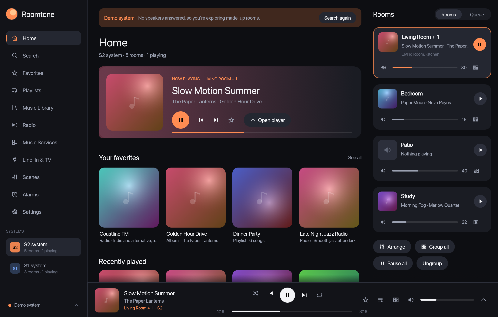
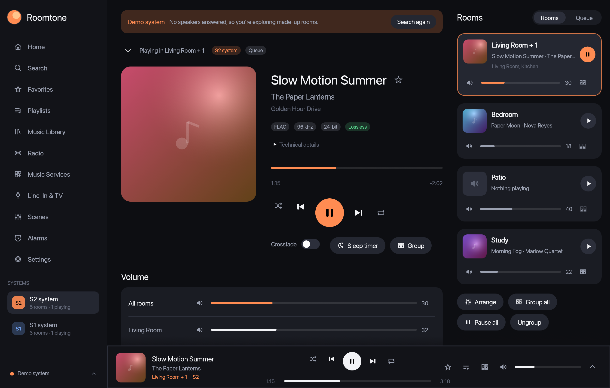
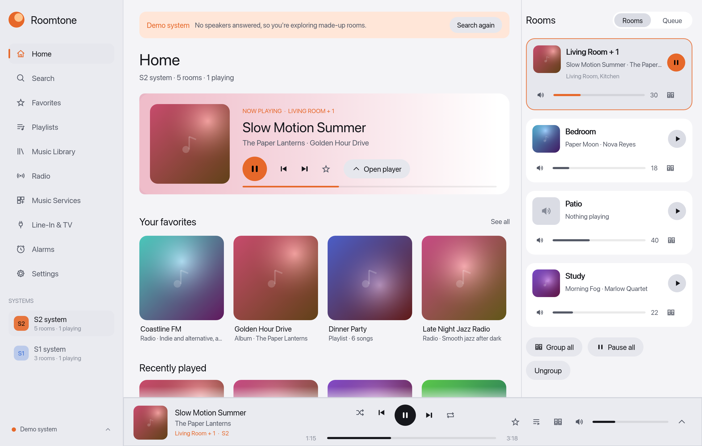
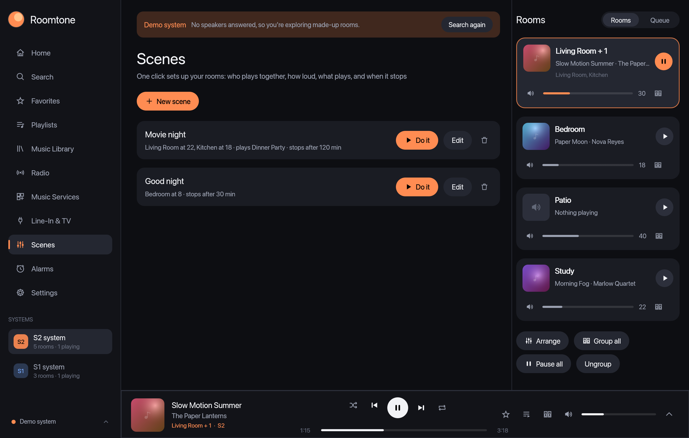

# Roomtone

[](https://github.com/ChrispyGee/Roomtone/actions/workflows/ci.yml)
[](#licence)


## Why Roomtone
Sonos does not have a great history of supporting legacy products.  Many people have S1 hardware that is still perfectly good and are artifically constrained to the older software.  Sonos does not support mixed S1 and S2 devices, you need separate apps, separate queues and use different UIs.

Roomtone is a modern desktop controller for wireless speaker systems. It controls both **S1** (legacy firmware 11.x) and **S2** systems directly over the home network (IKEA SYMFONISK speakers are Sonos hardware and should work too, but none has been tried yet; reports welcome), with no cloud account of its own. It can also run **without a window** and let **AI assistants** control the speakers through the **Model Context Protocol (MCP)**.

Written in Rust with [egui](https://github.com/emilk/egui). It is portable.  It runs on macOS, Windows and Linux. In English, German, French, Spanish, Italian and Dutch.  It is intended to be small, fast and easy to extend.

There are no ads, no call-homes and you can run it completely offline.



## What it does

- **Both generations in one app**: S1 and S2 systems are found automatically and shown side by side. *Play along* makes rooms in an S1 and an S2 system play the same music together.
- **Volume limits**: a highest volume per room and quiet hours, applied to everything Roomtone sends (the speakers can't hold a limit themselves).
- **Rooms and groups**: group and room volume, saved groups ("Downstairs"), group all, pause all; drag one room onto another to group them.
- **Playback**: queue editing (drag songs to reorder; drop songs or folders from your computer on the window to play them), shuffle, repeat, crossfade, sleep timer, line-in and TV inputs, alarms (experimental, including a fade-in over 1 to 30 minutes), room sound settings (including a sub, surround speakers and a soundbar's lip-sync delay).
- **Music from everywhere**: the system's library, folders on this computer, favorites and playlists, internet radio, podcasts, the Internet Archive, and streaming services (sign in to Spotify, Amazon Music, Deezer, TIDAL or Qobuz; favorites from Apple Music, YouTube Music and SoundCloud). One search box covers them all.
- **In the Mac menu bar or the Windows notification area (experimental)**: an optional speaker icon with what's playing, play and pause, volume and your rooms, and Roomtone can keep running there when the window is closed. (The Windows icon hasn't been tried on a Windows PC yet; Linux has none yet.)
- **Speaker setup (experimental)**: make or split stereo pairs and add or remove a soundbar's sub and rear speakers (off until you switch it on; not yet tried on real speakers).
- **Software updates** for each system, with S1 kept on S1.
- **Moving between networks**: Roomtone remembers the systems it has seen, starts on one that answers, and forgets old ones after 30 days (or at once with *Forget* in Settings › Speakers).
- **Scenes**: one click sets up a set of rooms: who plays together, how loud, what plays (shuffled if you like) and when it stops ("Movie night"). On a Scenes page (an optional page: switch it on in Settings › Appearance › Pages you use), as buttons on Home, from the command line and for assistants. A scene can also set a room's home-theatre sound and (experimental) a stereo-pair and soundbar layout, which is made only after you confirm.
- **Now-playing display (experimental)** (optional, off by default): a read-only web address showing the cover and song that's playing, for a picture frame, tablet or small screen on your network (also the cover alone as a JPEG, and a JSON description, for Home Assistant and scripts).
- **Stream Deck plugin (experimental)**: buttons and a dial for play/pause, skip, volume, mute and scenes, using the assistant link. Build it from [streamdeck/](streamdeck/README.md); not yet tried on a real Stream Deck.
- **Assistant link (MCP)**: 67 tools (status, playback, volume, browse and search, favorites, queue, grouping, scenes, alarms, rooms, services, stations, podcasts, backups and updates), live resources that assistants can follow for changes, ready-made prompts and name suggestions. Off by default, with look-only mode, a separate switch for each kind of change (saved items, alarms, names and sound, speaker updates, saving files into a folder you choose) and an access key.
- **Command line**: `roomtone play`, `volume 30 --room Kitchen`, `scene "Movie night"`, `backup file.json` and more control the running app, for scripts, Stream Deck and Shortcuts.
- **Backup and restore** of favorites, playlists and alarms, and playlists as M3U, PLS, XSPF or CSV files, to move between S1 and S2 or between apps.
- **Keep systems in step**: with an S1 and an S2 system, one card adds the favorites, playlists and alarms each has to the other, after showing exactly what would be added (it never removes anything).
- **Stream details (experimental)**: an optional switch shows an internet radio stream's bitrate and sample rate, or a podcast episode's average bitrate, in Technical details, read from the stream or file itself (off by default).
- **Lyrics (experimental)**: an optional switch shows the words of the song that's playing, following along when they're timed (fetched from lrclib.net; off by default).
- **Podcasts that remember**: skip back and forward, where you stopped, *Continue listening*. **Listening history** kept on this computer only, with a History page.
- A window that remembers its size and position.
- **Keyboard and screen readers**: Tab reaches every control with a visible focus ring, sliders take arrow keys and say their value in words, Ctrl or Cmd with 1 to 9 picks a room, a *High contrast* setting strengthens the colours, and every hand-drawn control is named for VoiceOver, Narrator, NVDA and Orca (works with VoiceOver on macOS; not yet tried with the others).
- **When something's wrong**: *Can't find your speakers?* runs a read-only check with plain advice and a report with no names or addresses; *Your speakers* shows whether each room is wired or wireless; a check tells you which of your speakers could move to S2; an optional, off-by-default check for new Roomtone versions.
- **Light, dark or automatic** appearance.
- A **demo system** with made-up rooms, so you can try everything without speakers.







## Install

> [!TIP]
> **Windows:** the easiest way is the **[Microsoft Store](https://apps.microsoft.com/detail/9MXNHZ6K9NJQ)**: one click, automatic updates, no warning. **Mac:** the download is signed and notarised by Apple, so it opens normally. Say **Allow** when it asks to find devices on your local network, or it can't see your speakers.
>
> The Windows installer on GitHub isn't signed, so SmartScreen warns the first time: **More info › Run anyway**. Step by step, and how to check your download: **[Opening Roomtone for the first time](docs/FIRST_RUN.md)**.

Download Roomtone 0.9.6 (or see [all releases](https://github.com/ChrispyGee/Roomtone/releases/latest) and what changed):

| System | Download | How |
| --- | --- | --- |
| macOS (Apple silicon) | [`roomtone-v0.9.6-macos-arm64.dmg`](https://github.com/ChrispyGee/Roomtone/releases/download/v0.9.6/roomtone-v0.9.6-macos-arm64.dmg) | Open it and drag Roomtone to Applications. Apple silicon only. Signed and notarised by Apple. |
| Windows 10/11 (Store) | [Roomtone in the Microsoft Store](https://apps.microsoft.com/detail/9MXNHZ6K9NJQ) | One click, updates itself, signed by Microsoft. The easiest way. |
| Windows 10/11 | [`roomtone-v0.9.6-windows-x64-setup.exe`](https://github.com/ChrispyGee/Roomtone/releases/download/v0.9.6/roomtone-v0.9.6-windows-x64-setup.exe) | Run it. It installs for your user only. SmartScreen warns because this installer isn't signed: choose *More info*, then *Run anyway* ([details](docs/FIRST_RUN.md#windows-10-and-11)). |
| Debian, Ubuntu and similar | [`roomtone-v0.9.6-linux-x64.deb`](https://github.com/ChrispyGee/Roomtone/releases/download/v0.9.6/roomtone-v0.9.6-linux-x64.deb) | `sudo apt install ./roomtone-v0.9.6-linux-x64.deb` |
| Fedora, openSUSE, RHEL and similar | [`roomtone-v0.9.6-linux-x64.rpm`](https://github.com/ChrispyGee/Roomtone/releases/download/v0.9.6/roomtone-v0.9.6-linux-x64.rpm) | `sudo dnf install ./roomtone-v0.9.6-linux-x64.rpm` |
| macOS (Homebrew) | `brew install --cask ChrispyGee/roomtone/roomtone` | Installs the same `.dmg` app from the project's tap. |

**Advanced: no installer.** Most people should use the installers above. Each release also has plain archives holding just the program, the README and the licences, for running without installing: [`roomtone-v0.9.6-macos-arm64.tar.gz`](https://github.com/ChrispyGee/Roomtone/releases/download/v0.9.6/roomtone-v0.9.6-macos-arm64.tar.gz) and [`roomtone-v0.9.6-windows-x64.zip`](https://github.com/ChrispyGee/Roomtone/releases/download/v0.9.6/roomtone-v0.9.6-windows-x64.zip) (the bare program, without the app icon or the Mac app, handy for the command line, a computer with no screen, or a portable copy) and [`roomtone-v0.9.6-linux-x64.tar.gz`](https://github.com/ChrispyGee/Roomtone/releases/download/v0.9.6/roomtone-v0.9.6-linux-x64.tar.gz) (for Linux systems that use neither `.deb` nor `.rpm`).

Every download's checksum is in [`SHA256SUMS`](https://github.com/ChrispyGee/Roomtone/releases/download/v0.9.6/SHA256SUMS) (check with `shasum -a 256 -c` or `sha256sum -c`).

## Build it yourself

You need a recent stable Rust toolchain from <https://rustup.rs> (developed and tested with Rust 1.99).

```sh
git clone https://github.com/ChrispyGee/Roomtone.git
cd Roomtone
cargo build --release          # the program is target/release/roomtone (roomtone.exe on Windows)
./target/release/roomtone       # finds your speakers; shows the demo if none answer
./target/release/roomtone --demo
```

On Linux, install the desktop development packages first, for example on Debian or Ubuntu:
`sudo apt install libxkbcommon-dev libgtk-3-dev libwayland-dev libxcb-render0-dev libxcb-shape0-dev libxcb-xfixes0-dev libssl-dev`.

On macOS, allow Local Network access when asked (System Settings › Privacy & Security › Local Network), or no speakers will appear.

### More ways to run it

```sh
roomtone --lang de       # language for this run (en, de, fr, es, it, nl)
roomtone --theme light   # appearance for this run (auto, light, dark)
roomtone --headless      # no window: keep the speakers up to date and serve the assistant link over HTTP
roomtone --mcp           # no window: serve the assistant link on stdin/stdout
roomtone --mcp-on        # switch the assistant link on (it's off until you do)
roomtone play            # control the running app: play, pause, next, volume 30, scene "Movie night" …
roomtone --help          # every option (and the control commands)
roomtone --help mcp      # how to connect an assistant, written for the computer you're on
```

Step-by-step guides for macOS, Windows and Linux (including starting it automatically in the background) are in [docs/HEADLESS_AND_MCP.md](docs/HEADLESS_AND_MCP.md).

## Documentation

| Document | What's in it |
| --- | --- |
| [docs/SETTINGS.md](docs/SETTINGS.md) | **Every setting**: what it does, where it is in the app, its name in `config.json`, defaults, command-line options, and how to back up, move or reset |
| [SPEC.md](SPEC.md) | What the app does: every feature, setting, option, stored file and port, what's verified, and acceptance checks |
| [docs/ARCHITECTURE.md](docs/ARCHITECTURE.md) | How the code fits together, conventions, and how to add features, languages and assistant tools |
| [docs/PROTOCOL.md](docs/PROTOCOL.md) | How the app talks to the speakers and streaming services |
| [docs/HEADLESS_AND_MCP.md](docs/HEADLESS_AND_MCP.md) | Running without a window and connecting AI assistants, per platform |
| [docs/ROADMAP.md](docs/ROADMAP.md) | Open questions and ideas, and where help is needed |
| [docs/RELEASING.md](docs/RELEASING.md) | Publishing and making releases |
| [CHANGELOG.md](CHANGELOG.md) | What changed in each version |
| [AGENTS.md](AGENTS.md) | Rules and commands for AI coding agents |

`cargo doc --no-deps --open` shows the code documentation.

## Where things are kept

| Platform | Folder |
| --- | --- |
| macOS | `~/Library/Application Support/Roomtone/` |
| Windows | `%APPDATA%\Roomtone\` |
| Linux | `~/.config/roomtone/` |

`config.json` holds your settings, scenes, sign-ins and the assistant access key, readable only by you; every setting is explained in the [settings guide](docs/SETTINGS.md). `speakers.json` remembers your speakers for a fast start, `songs.json` keeps song details, `history.json` your listening history, `podcast-progress.json` where you stopped in episodes and `window.json` the window's size and position. Nothing is sent anywhere except to your speakers, the music sources you use, the services you sign in to and, only if you switch them on, lrclib.net for lyrics and the playing stream's or episode's own address for its bitrate. There's no telemetry.

## Contributing

Contributions are welcome: code, translations, docs, and especially **reports from real speakers** (several features are only verified on the demo system). [Open an issue](https://github.com/ChrispyGee/Roomtone/issues/new/choose) or a pull request. See [CONTRIBUTING.md](CONTRIBUTING.md) and the [Code of Conduct](CODE_OF_CONDUCT.md). Report security problems privately, as described in [SECURITY.md](SECURITY.md).
Roomtone has been built agenticaly in a clean-room.  Credit [Craft Anything](https://github.com/storytold/craft-anything)

## Licence

Dual-licensed under either of

- [MIT licence](LICENSE-MIT)
- [Apache License, Version 2.0](LICENSE-APACHE)

at your option. Unless you say otherwise, any contribution you submit for inclusion is dual-licensed the same way, without additional terms or conditions.

## Disclaimer

Roomtone is an independent project. It isn't made, endorsed or supported by any speaker maker or music service, and their names and trademarks belong to their owners. It uses the speakers' local network interfaces, which may change with their software updates.
