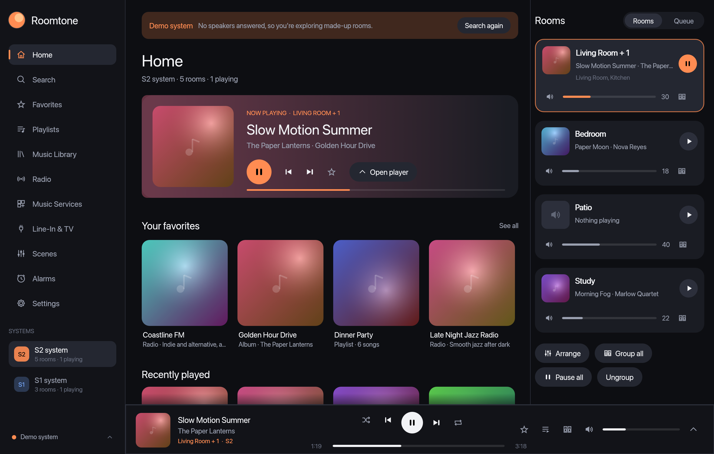
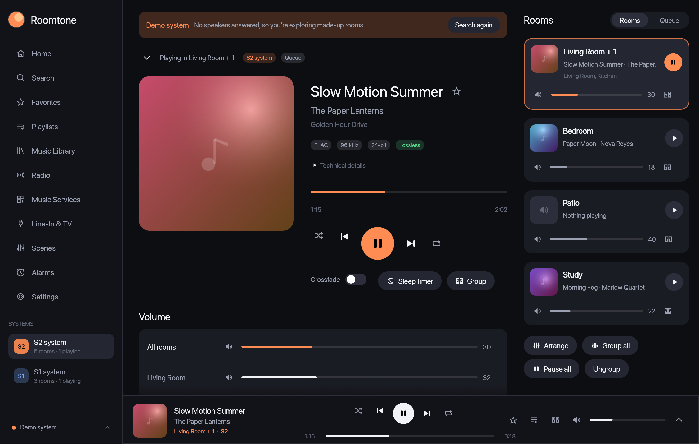
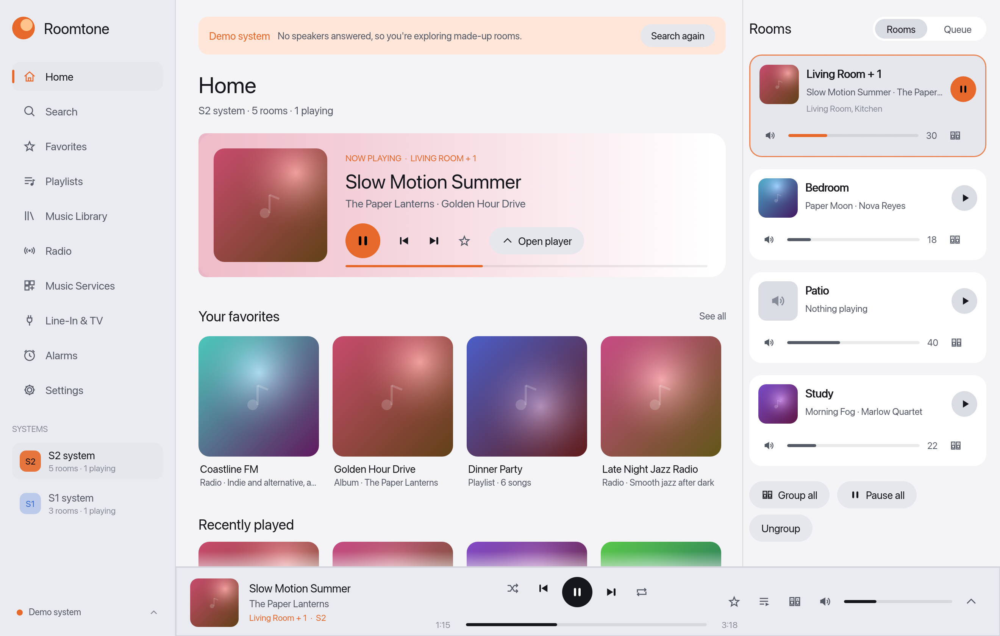

# Roomtone

[](https://github.com/ChrispyGee/Roomtone/actions/workflows/ci.yml)
[](#licence)


## Why Roomtone
Sonos does not have a great history of supporting legacy products.  Many people have S1 hardware that is still perfectly good and are artifically constrained to the older software.  Sonos does not support mixed S1 and S2 devices, you need separate apps, separate queues and use different UIs.

Roomtone is a modern desktop controller for wireless speaker systems. It controls both **S1** (legacy firmware 11.x) and **S2** systems directly over the home network, with no cloud account of its own. It can also run **without a window** and let **AI assistants** control the speakers through the **Model Context Protocol (MCP)**.

Written in Rust with [egui](https://github.com/emilk/egui). It is portable.  It runs on macOS, Windows and Linux. In English, German, French, Spanish, Italian and Dutch.  It is intended to be small, fast and easy to extend.

There are no ads, no call-homes and you can run it completely offline.



## What it does

- **Both generations in one app**: S1 and S2 systems are found automatically and shown side by side. *Play along* makes rooms in an S1 and an S2 system play the same music together.
- **Rooms and groups**: group and room volume, saved groups ("Downstairs"), group all, pause all.
- **Playback**: queue editing, shuffle, repeat, crossfade, sleep timer, line-in and TV inputs, alarms, room sound settings.
- **Music from everywhere**: the system's library, folders on this computer, favorites and playlists, internet radio, podcasts, the Internet Archive, and streaming services (sign in to Spotify, Amazon Music, Deezer, TIDAL or Qobuz; favorites from Apple Music, YouTube Music and SoundCloud). One search box covers them all.
- **Software updates** for each system, with S1 kept on S1.
- **Assistant link (MCP)**: 48 tools (status, playback, volume, browse and search, favorites, queue, grouping, alarms, rooms, services, stations, podcasts and updates), live resources, ready-made prompts and name suggestions. Off by default, with look-only mode and an access key.
- **Light, dark or automatic** appearance.
- A **demo system** with made-up rooms, so you can try everything without speakers.





## Install

Download the latest from the [Releases page](https://github.com/ChrispyGee/Roomtone/releases/latest):

| System | File | How |
| --- | --- | --- |
| macOS (Apple silicon) | `roomtone-v…-macos-arm64.dmg` | Open it and drag Roomtone to Applications. The app isn't signed by Apple yet: the first time, right-click it and choose *Open*. |
| Windows 10/11 | `roomtone-v…-windows-x64-setup.exe` | Run it. It installs for your user only. SmartScreen may warn because the installer isn't signed: choose *More info*, then *Run anyway*. |
| Debian, Ubuntu and similar | `roomtone-v…-linux-x64.deb` | `sudo apt install ./roomtone-v…-linux-x64.deb` |
| Fedora, openSUSE, RHEL and similar | `roomtone-v…-linux-x64.rpm` | `sudo dnf install ./roomtone-v…-linux-x64.rpm` |
| Any | the `.zip` / `.tar.gz` | Just the program, README and licences; unpack and run. |

## Build it yourself

You need a recent stable Rust toolchain from <https://rustup.rs> (developed and tested with Rust 1.99).

```sh
git clone https://github.com/ChrispyGee/Roomtone.git
cd Roomtone
cargo build --release          # the program is target/release/roomtone (roomtone.exe on Windows)
./target/release/roomtone       # finds your speakers; shows the demo if none answer
./target/release/roomtone --demo
```

On Linux, install the desktop development packages first, for example on Debian or Ubuntu:
`sudo apt install libxkbcommon-dev libgtk-3-dev libwayland-dev libxcb-render0-dev libxcb-shape0-dev libxcb-xfixes0-dev libssl-dev`.

On macOS, allow Local Network access when asked (System Settings › Privacy & Security › Local Network), or no speakers will appear.

### More ways to run it

```sh
roomtone --lang de       # language for this run (en, de, fr, es, it, nl)
roomtone --theme light   # appearance for this run (auto, light, dark)
roomtone --headless      # no window: keep the speakers up to date and serve the assistant link over HTTP
roomtone --mcp           # no window: serve the assistant link on stdin/stdout
roomtone --mcp-on        # switch the assistant link on (it's off until you do)
roomtone --help          # every option
roomtone --help mcp      # how to connect an assistant, written for the computer you're on
```

Step-by-step guides for macOS, Windows and Linux (including starting it automatically in the background) are in [docs/HEADLESS_AND_MCP.md](docs/HEADLESS_AND_MCP.md).

## Documentation

| Document | What's in it |
| --- | --- |
| [SPEC.md](SPEC.md) | What the app does: every feature, setting, option, stored file and port, what's verified, and acceptance checks |
| [docs/ARCHITECTURE.md](docs/ARCHITECTURE.md) | How the code fits together, conventions, and how to add features, languages and assistant tools |
| [docs/PROTOCOL.md](docs/PROTOCOL.md) | How the app talks to the speakers and streaming services |
| [docs/HEADLESS_AND_MCP.md](docs/HEADLESS_AND_MCP.md) | Running without a window and connecting AI assistants, per platform |
| [docs/ROADMAP.md](docs/ROADMAP.md) | Open questions and ideas, and where help is needed |
| [docs/RELEASING.md](docs/RELEASING.md) | Publishing and making releases |
| [CHANGELOG.md](CHANGELOG.md) | What changed in each version |
| [AGENTS.md](AGENTS.md) | Rules and commands for AI coding agents |

`cargo doc --no-deps --open` shows the code documentation.

## Where things are kept

| Platform | Folder |
| --- | --- |
| macOS | `~/Library/Application Support/Roomtone/` |
| Windows | `%APPDATA%\Roomtone\` |
| Linux | `~/.config/roomtone/` |

`config.json` holds your settings, sign-ins and the assistant access key, readable only by you. `speakers.json` remembers your speakers for a fast start, and `songs.json` keeps song details. Nothing is sent anywhere except to your speakers, the music sources you use and the services you sign in to. There's no telemetry.

## Contributing

Contributions are welcome: code, translations, docs, and especially **reports from real speakers** (several features are only verified on the demo system). [Open an issue](https://github.com/ChrispyGee/Roomtone/issues/new/choose) or a pull request. See [CONTRIBUTING.md](CONTRIBUTING.md) and the [Code of Conduct](CODE_OF_CONDUCT.md). Report security problems privately, as described in [SECURITY.md](SECURITY.md).
Roomtone has been built agenticaly in a clean-room.  Credit [Craft Anything](https://github.com/storytold/craft-anything)

## Licence

Dual-licensed under either of

- [MIT licence](LICENSE-MIT)
- [Apache License, Version 2.0](LICENSE-APACHE)

at your option. Unless you say otherwise, any contribution you submit for inclusion is dual-licensed the same way, without additional terms or conditions.

## Disclaimer

Roomtone is an independent project. It isn't made, endorsed or supported by any speaker maker or music service, and their names and trademarks belong to their owners. It uses the speakers' local network interfaces, which may change with their software updates.
